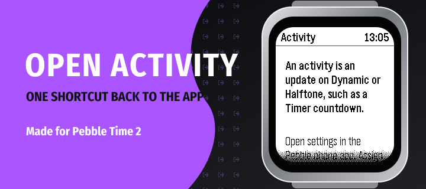

# Open Activity

A Quick Launch shortcut to the app behind a recent activity on Dynamic or Halftone.



[Artwork provenance](store/artwork-provenance.json). Separate native emulator example states; not a synchronized recording.

## Download

**Open Activity 1.0.2 is published in [Pebble Store](https://apps.repebble.com/59af0a59f7a34cb09a79bcbe).**
The [product page](https://xefensor.github.io/xoce/projects/open-activity/) provides installation, setup, support and privacy links.

Matching [GitHub release v1.0.2](https://github.com/xefensor/pebble-app-open-activity/releases/tag/v1.0.2):

- [PBW](https://github.com/xefensor/pebble-app-open-activity/releases/download/v1.0.2/Open-Activity-1.0.2.pbw)
- [Source](https://github.com/xefensor/pebble-app-open-activity/releases/download/v1.0.2/Open-Activity-1.0.2-source.zip)
- [Debug files](https://github.com/xefensor/pebble-app-open-activity/releases/download/v1.0.2/Open-Activity-1.0.2-debug.zip)
- [Checksums](https://github.com/xefensor/pebble-app-open-activity/releases/download/v1.0.2/SHA256SUMS.txt)

Install one PBW through the Pebble phone app. It includes the watchapp and its phone-side components; no separate library installation is needed. Earlier releases remain available in [release history](https://github.com/xefensor/pebble-app-open-activity/releases).

## Compatibility

The published release targets **Pebble Time 2 / Emery** and **Round 2 / Gabbro**, built with **Pebble SDK 4.44**. Duo is excluded.

Requires Dynamic or Halftone, plugin support in the official Pebble phone app, a connected phone and **Launch Apps** permission. The activity must provide an installed destination app. Use one connected watch.

## Setup and use

Install a current Dynamic or Halftone separately. Open Open Activity from the watch app list for setup. In its phone settings choose that watchface and the large Primary or smaller Secondary activity, then Save. Assign Open Activity to the same shortcuts in Pebble Quick Launch. Update the source choice when switching watchfaces. Use one connected watch.

[Usage and controls](docs/USAGE.md) · [Current UI](docs/UI.md) · [Troubleshooting and support](SUPPORT.md).

## Activities: see what is happening now

Activities are updates about something happening now, such as a countdown, music or a notification. Compatible XOCE products decide how to display them.

When Timer is visible on your selected watchface, a configured Quick Launch shortcut can open Timer. Open Activity opens the associated app as a whole, not a particular timer, song or notification. Opening it from the app list stays in setup; only a configured Quick Launch shortcut attempts to open an activity.

Weather and battery readings use separate reading settings. Open Activity is optional; an app can always be opened from the watch's app list.

## Display settings and languages

The phone settings provide **Text Size** and **Light/Dark** watch appearance. Follow Pebble text size uses the watch's preference. Automatic Follow Pebble appearance is unavailable in this build; the page explains the saved Light/Dark fallback. Phone-page appearance follows the phone independently.

A confirmed Save means the choices were stored on the phone. Pending watch delivery and Applied on watch are separate states. Saving stays open on the supported embedded settings route; the legacy return-URL route follows its documented closing behaviour.

The release supports English, Czech, Slovak, German, French, Spanish, Italian, Portuguese, Dutch, Polish, Danish, Swedish, Norwegian, Finnish, Hungarian, Romanian and Turkish. Unsupported languages use English. Provider text, user labels and saved bindings keep their original values.

## Verification scope

[Release readiness](docs/RELEASE-READINESS.md) links the version-bound source, package and emulator evidence. Publication is complete; no physical phone/watch or live-provider result is implied by that status. Earlier captures retain their actual versions and provenance.

## Development

Use the pinned Node 22.23.4 and Python 3.12.15 runtimes and a C compiler. Native builds additionally need Pebble SDK 4.44; the [contributor guide](CONTRIBUTING.md) documents its isolated bootstrap.

```sh
npm ci --ignore-scripts
npm test
npm run build
npm run check:artifact
```

[Contributor guide](CONTRIBUTING.md) · [Release workflow](docs/RELEASING.md) · [History index](docs/history/index.md).
Development outputs belong in ignored `build/`; published archives stay frozen. The current bundled UI package is 0.1.3; Open Activity does not depend on the Activities package.

## Licence

[PolyForm Noncommercial 1.0.0](LICENSE). Preserve [third-party notices](THIRD-PARTY-NOTICES.md) and attribution. See [privacy](PRIVACY.md) for app-owned data handling.

## Earlier release notes

<span id="store-update-101"></span>

<span id="version-033"></span>

<span id="version-100--stable-release-preparation"></span>

The earlier Store-update preparation, development download and version notes remain in the [README snapshot before this documentation refresh](https://github.com/xefensor/pebble-app-open-activity/blob/3c4a5cc53cc0ba02a2e2a55665226d733466d463/README.md). Those notes describe their original versions and evidence, not the current installation.
